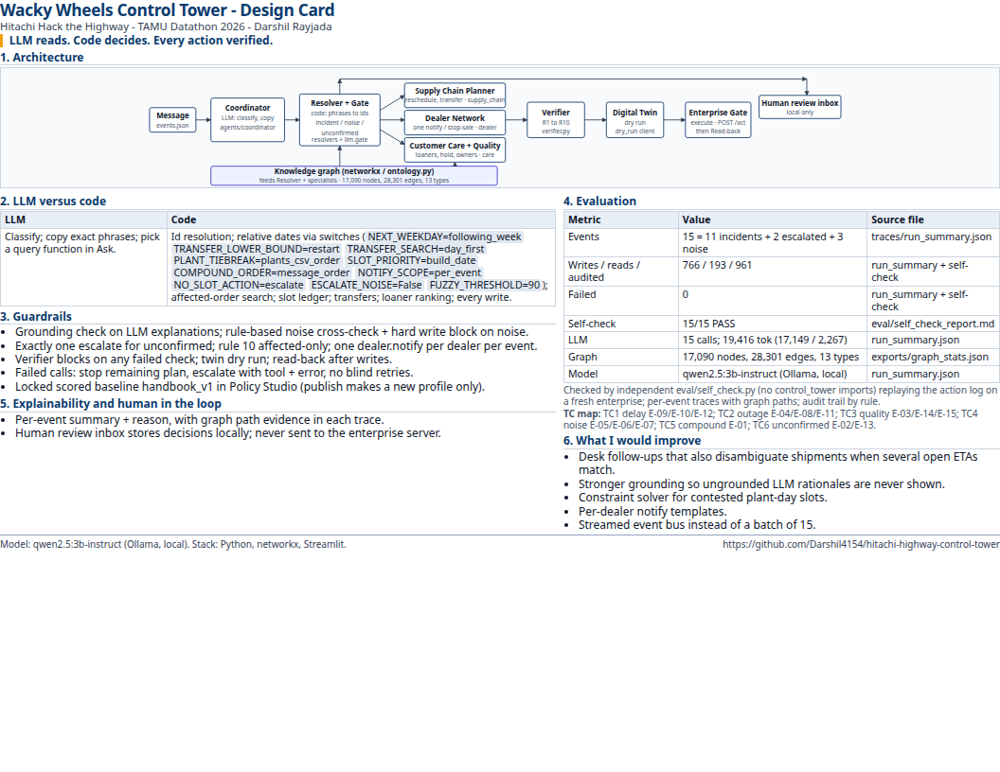

# Wacky Wheels Control Tower

Event-driven multi-agent control tower for Hitachi Hack the Highway (TAMU Datathon 2026). It reads the 15 operational messages, uses a small local LLM only to classify and copy phrases, resolves ids and dates in code, plans corrective actions from `handbook_v1`, dry-runs them in a digital twin, verifies R1-R10, executes through the enterprise gate, and records a graph path, summary, and audit trail for every event. **LLM reads. Code decides. Every action verified.**



## How to run

```bash
python -m venv .venv && source .venv/bin/activate
pip install -r requirements.txt
# optional local model for live Desk classification
# ollama pull qwen2.5:3b-instruct
streamlit run ui/app.py --server.port 8517
```

Self-check the scored action log (independent of `control_tower`):

```bash
python eval/self_check.py --log runs/final_v2/action_log.jsonl
```

## Model citation

`qwen2.5:3b-instruct` via Ollama, local. Temperature 0. One call per event. Source: `traces/run_summary.json` (`llm_model`, 15 LLM calls, 17,149 prompt / 2,267 completion tokens).

## Design card and submission

- One-page design card: [docs/design_card.pdf](docs/design_card.pdf) (source [docs/design_card.html](docs/design_card.html))
- Packaged submission copy: [submission/](submission/) (also `submission.zip`, gitignored)

## Scored run (frozen)

| Metric | Value | Source |
|---|---|---|
| Events | 15 (11 incidents, 2 escalated, 3 noise) | `traces/run_summary.json` |
| Writes / reads / audited calls | 766 / 193 / 961 | `traces/run_summary.json`, self-check |
| Failed calls | 0 | `traces/run_summary.json` |
| Self-check | 15/15 PASS | `eval/self_check_report.md` |
| Graph | 17,090 nodes, 28,301 edges, 13 types | `exports/graph_stats.json` |

Do not re-run the scored path against the enterprise server. The Live Incident Desk, Scenario Lab, What-if, and Policy Studio drafts are twin-only sandboxes.
