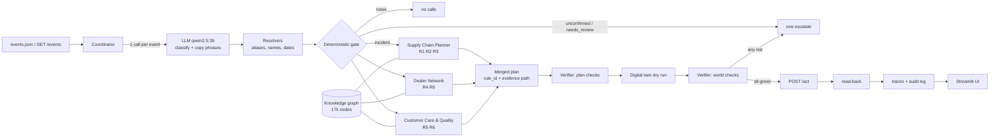

# Design card - Wacky Wheels Control Tower

**Problem.** A just-in-time automaker with no parts inventory receives messy operational messages (emails, chats,
bulletins). Each must be understood, traced through the company data, and turned into exactly the corrective actions
the handbook demands: no more, no less. **Personas:** Production Planner (slots, transfers), Dealer Relations
Manager (who to tell), Customer Care Lead (loaners, owners), Quality Engineer (lots, stop sale), Auditor (why).

| LLM does | Code does |
|---|---|
| category (incident / noise / unconfirmed), one object per incident, evidence quote, raw phrases ("next Friday", "the Texas plant") | id resolution (regex, aliases.csv, names, fuzzy-as-suggestion), date math, shipment/lot validation, graph traversal, slot search, loaner ranking, tool arguments, execution order, verification, summaries |

**Agents.** Coordinator (gate, routing, shared slot + loaner ledgers, execution, trace); Supply Chain Planner;
Dealer Network; Customer Care & Quality; Verifier (guardrail, recomputes from the tables).

**Guardrails.** pydantic schema + one retry + rule-based fallback; LLM phrases must appear verbatim in the message;
hedge-word detector; required fields per incident type; weekday/date consistency; shipment and lot cross-validation;
tool-client write guard (noise/rumor events cannot write); digital-twin dry run (must be 0 errors); verifier plan
and world checks (R1-R10); stop on first live failure (no blind retries); live read-back; human-in-the-loop inbox.

**Evaluation.** `pytest -q`: 77 tests, specialists tested on synthetic mini-worlds. Real server run: 961 calls,
**0 failed**. `eval/self_check.py` replays the action log on a fresh `Enterprise` and scores it against a separate
minimal implementation of R1-R6 and R9-R10: **15/15 events green**. Both qwen2.5 3B and 7B pass the extraction table;
the rule-based fallback alone also passes.

**Interpretation switches** (`control_tower/config.py`, printed in every trace): NEXT_WEEKDAY=following_week,
TRANSFER_LOWER_BOUND=today, PLANT_TIEBREAK=plants_csv_order, COMPOUND_ORDER=message_order, NOTIFY_SCOPE=per_event,
NO_SLOT_ACTION=escalate, QUALITY_DEALER_NOTIFY=False, ESCALATE_NOISE=False.

**Model.** `qwen2.5:3b-instruct` (Alibaba Qwen 2.5, 3B parameters, Q4 via Ollama, 1.9 GB, local, temperature 0,
cached). Chosen because it matches the 7B model on all 15 events at about half the latency and memory, and the LLM
only has to classify and copy phrases. One LLM call per event: 17.1k prompt and 2.3k completion tokens for all 15 events (about 1.1k / 150 per
event).

**What we would improve.** Confirm the interpretation switches with the organizers; LLM-written business summaries
(facts still from the trace); a constraint solver for slot assignment when many incidents compete; per-dealer
message templates; a streaming event bus instead of a batch run; the 3D "agent village" view and the
"Ask the control tower" query panel from the stretch plan.
